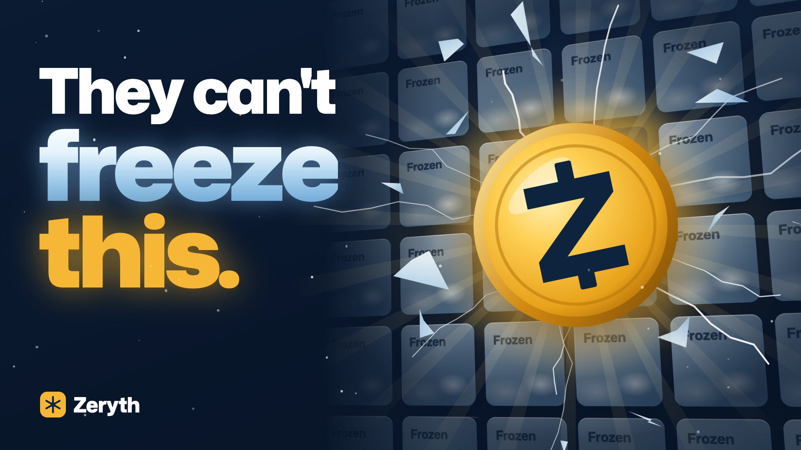
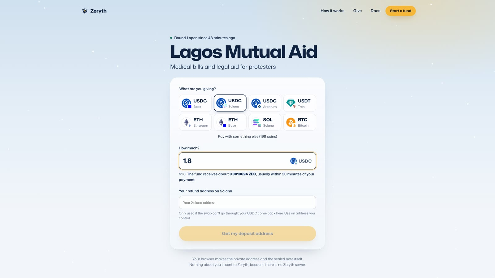
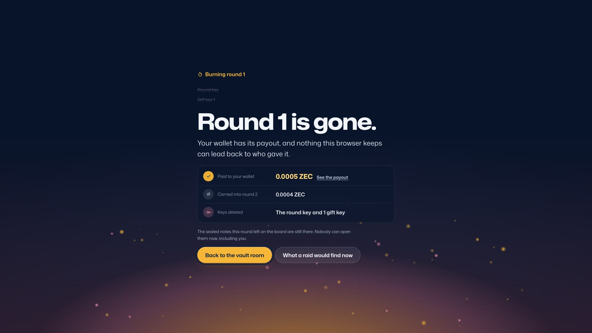
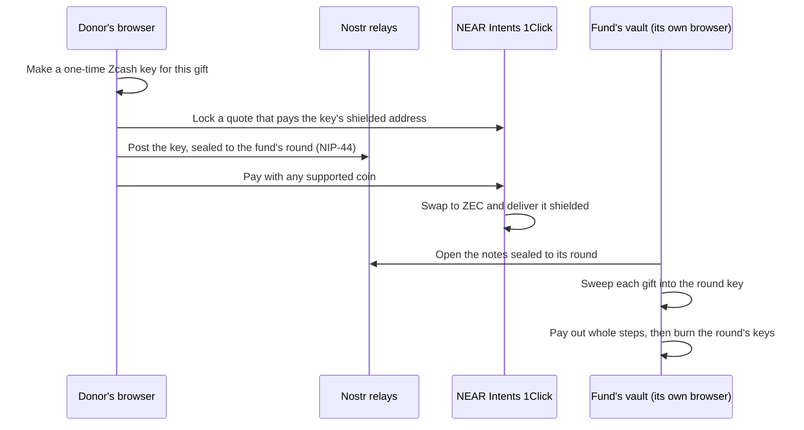

<p align="center">
  
</p>

<h1 align="center">Zeryth</h1>

<p align="center">
  <b>The fund they can't freeze.</b><br />
  Private donations from almost any chain, landing in shielded Zcash.
</p>

<p align="center">
  <a href="https://zeryth.vercel.app"></a>
  <a href="https://youtu.be/HONiTj4DVVk"></a>
  <a href="https://zeryth.vercel.app/#/doc"></a>
  
  
</p>

<p align="center">
  <a href="https://youtu.be/HONiTj4DVVk"></a>
</p>

## About

Zeryth is a donation fund for groups that can't rely on a bank. Anyone can give from almost any wallet, and the gift arrives as shielded Zcash that only the group can spend. After each payout the group burns its keys, so nothing it keeps can lead back to a donor.

In October 2020 the Feminist Coalition raised money in Lagos for #EndSARS protesters' medical bills, legal aid and food. Their donation link stopped working, so they moved to Bitcoin, where every gift and its sender is public. Weeks later a court order froze the bank accounts of twenty protesters. A group in that position needs donations that are hard to stop, and no list of donors to hand over. Zeryth is built for that.

- **Live app:** https://zeryth.vercel.app
- **Demo video (1:50):** https://youtu.be/HONiTj4DVVk
- **Docs, with every flow drawn out:** https://zeryth.vercel.app/#/doc

Built for ZECATHON 2026, Cross-Chain track. Everything runs on mainnet. There are no mocks and no Zeryth server.

## Features

- **Give from almost anything.** About 200 coins on more than 35 chains through NEAR Intents 1Click: USDC, USDT, ETH, SOL, BTC and more. The donor needs no Zcash, account or app.
- **Shielded on arrival.** Every gift lands in a one-time shielded Zcash address.
- **No server.** Donors and funds run everything in their own browsers. The site is static and works from any host, an IPFS gateway or a folder on disk.
- **Keys burned after every payout.** Once a round pays out, its keys are deleted, and the notes it received can't be opened by anyone, the fund included.
- **Raid report.** The vault shows exactly what someone who seized the fund's device would find.
- **Claim cards.** Printed QR cards, each holding a little Zcash. The holder can claim to a Zcash wallet or cash out to USDC on Solana, and the fund never keeps a list of who got which card.
- **Listed or private.** A fund can appear on the public Give page or share its own link only.

## Screenshots

| Give from any chain | Round burned after payout |
| :---: | :---: |
|  |  |

## How it works



1. **The donor picks a coin.** USDC on Base or Solana, ETH, BTC, or anything else NEAR Intents can swap.
2. **The donor's browser seals the gift.** It makes a brand-new Zcash key for this one gift, locks a NEAR Intents quote that pays that key's shielded address, and posts the key to a public Nostr board, encrypted to the fund's current round with no recipient tag. Only after two relays have stored the note does the page show the deposit address.
3. **The donor pays.** NEAR Intents swaps the payment to ZEC and delivers it, shielded, to the one-time address.
4. **The fund collects.** The fund's vault room, which runs in the fund's own browser, opens the notes meant for its round and sweeps each gift into the round key.
5. **Pay out and burn.** The fund closes the round and sends whole payout steps (0.01 ZEC by default) to its own wallet; the rest carries into the next round. Then the round's keys are deleted. The notes stay on the board, unreadable to everyone.

## Privacy

**What Zeryth hides**

- Who gave, how much, and to whom, once the gift is in the shielded pool.
- Which donor sent which gift, from anyone who takes the fund's device after a payout.
- That a note on the board is meant for a particular fund: notes carry no recipient tag.

**What it can't hide**

- Your side of the swap is public on the chain you paid from.
- NEAR Intents sees the swap. Relays and servers see IP addresses.
- Until a round burns, the fund (or anyone who takes its device) can follow a gift's deposit address back to the donor's wallet.
- Backups made before a burn still hold old keys.
- The software hasn't been audited.

The full list, with who can see what, is in the [docs](https://zeryth.vercel.app/#/doc/limits).

## Proven on mainnet

On 27 October 2026 we made a real gift through the live site:

| Step | Result |
| --- | --- |
| Donor pays | 1.8 USDC on Solana, from Phantom |
| NEAR Intents swap | 0.00104746 ZEC delivered shielded, in about 11 minutes |
| Fund collects | Gift swept into the round key |
| Payout and burn | 0.0005 ZEC landed in the fund's Zodl wallet, then the round's keys were deleted |

## Tech stack

| Layer | Built with |
| --- | --- |
| Wallet engine | Rust, adapted from [Zenvelope](https://github.com/IhorMuliar/zenvelope), compiled to WebAssembly with wasm-pack |
| Core | TypeScript: NEAR Intents 1Click, the Nostr board, donations, vault, cards |
| Web app | Vite, React, motion, GSAP, Lenis, three.js |
| Swaps | [NEAR Intents](https://docs.near-intents.org) 1Click |
| Board | [Nostr](https://nostr.com) relays, NIP-44 encryption |
| Zcash access | [zec.rocks](https://zec.rocks) and ChainSafe light servers |

## Project structure

```
apps/web               the site: Vite, React, motion, GSAP, Lenis, three.js
packages/core          TypeScript: NEAR Intents 1Click, the Nostr board, donations, vault, cards
packages/engine-wasm   the wallet engine, prebuilt (wasm-pack output, committed)
crates/engine          the wallet engine in Rust, adapted from Zenvelope (MIT)
crates/cli             `zeryth`, a native driver for the engine
scripts                real-money and end-to-end drivers for the terminal
```

## Getting started

You need Node 22 and pnpm 10.

```sh
pnpm install
pnpm --dir apps/web dev
```

To build the static site:

```sh
pnpm --dir apps/web build    # writes apps/web/dist
```

The build uses relative paths and hash routing, so it works from any static host, an IPFS gateway, or a folder on disk.

Testnet won't work: NEAR Intents 1Click only runs on mainnet. To try a full gift, start a fund with your own Zcash wallet as the payout address, then give a couple of dollars to it.

### Rebuild the wallet engine

The site uses the prebuilt engine in `packages/engine-wasm`, so building the site doesn't need Rust. To rebuild it:

```sh
rustup target add wasm32-unknown-unknown
cargo install wasm-pack
brew install llvm    # macOS: Apple's clang can't target wasm32
pnpm build:engine
```

`.cargo/config.toml` points the wasm build at Homebrew's clang. On Linux, set `CC_wasm32_unknown_unknown` and `AR_wasm32_unknown_unknown` to a clang and llvm-ar that support wasm32.

### Terminal drivers

These run the same core code against mainnet. State, including keys, is kept in `.zeryth/`, which is gitignored. Treat it as money.

```sh
npx tsx scripts/e2e-board.ts                  # the full handshake with live relays and a live quote; no money moves
npx tsx scripts/live.ts init [payout-ua]      # a new fund
npx tsx scripts/live.ts donate <asset> <amount> <refund-to>
npx tsx scripts/live.ts collect               # read the board, follow swaps, sweep arrivals
npx tsx scripts/live.ts rotate                # open a new round
npx tsx scripts/live.ts payout                # pay settled rounds out, then burn
npx tsx scripts/live.ts raid                  # what someone who took this device would find
```

## Credits

- [Zenvelope](https://github.com/IhorMuliar/zenvelope) by Ihor Muliar (MIT): the wallet engine Zeryth's is adapted from. Its license is in `crates/engine/LICENSE-zenvelope`.
- [NEAR Intents](https://docs.near-intents.org) 1Click: the swaps.
- [Nostr](https://nostr.com): the public board.
- [zec.rocks](https://zec.rocks) and ChainSafe: Zcash light servers.
- Demo film made with HyperFrames; voice and music from HeyGen.
